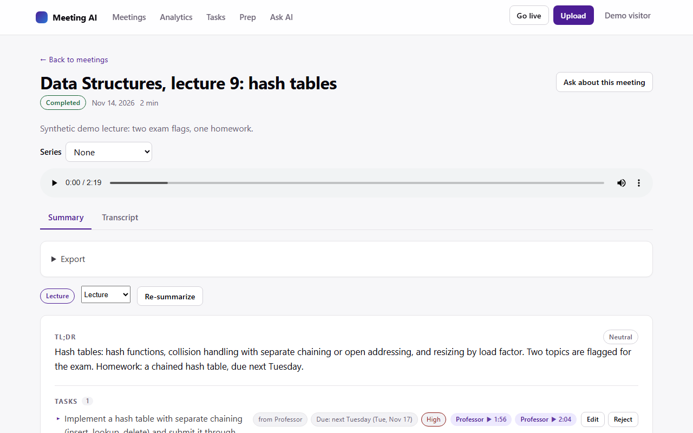
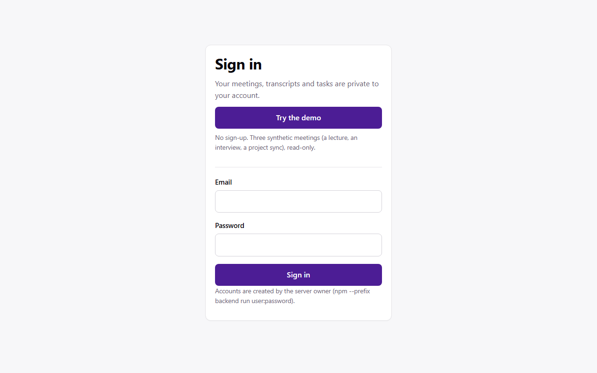
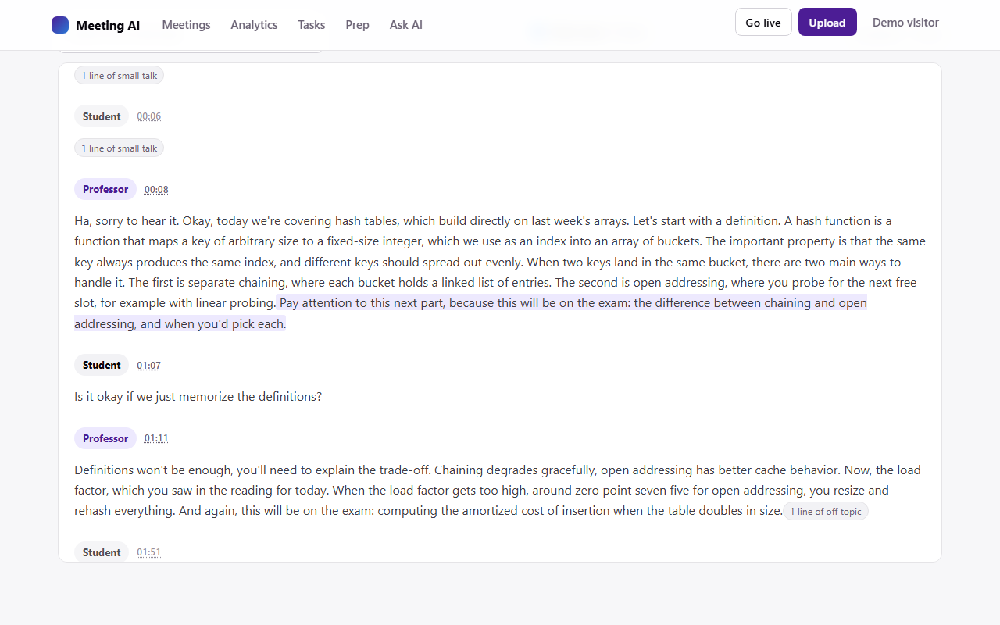
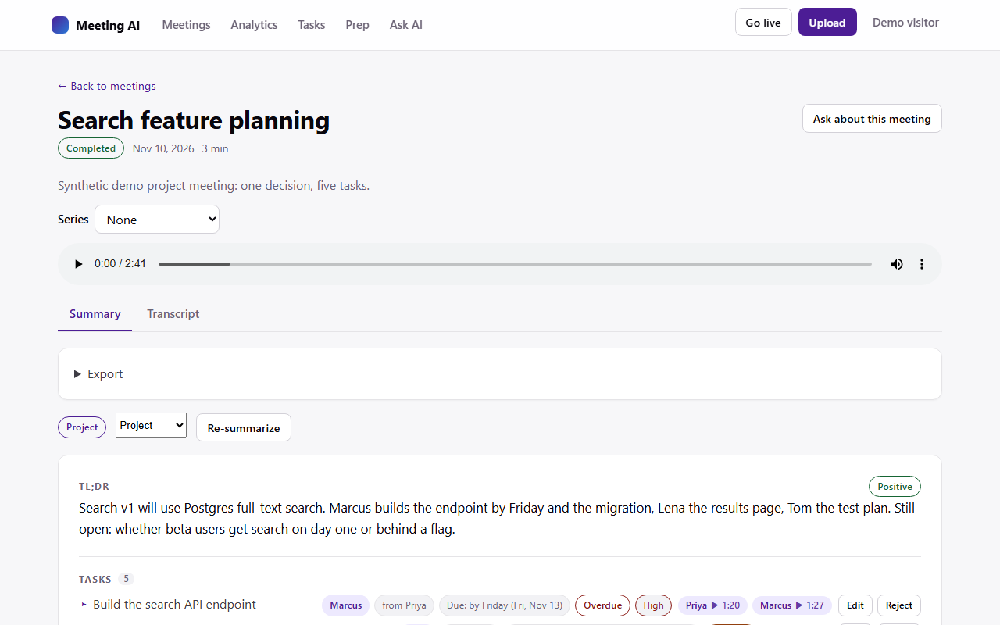
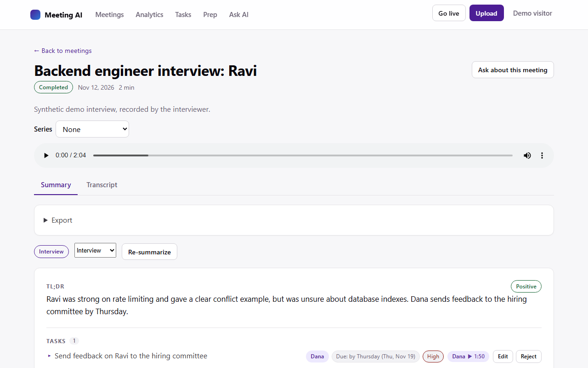
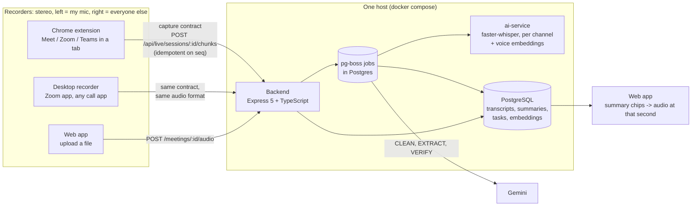

# Meeting companion

[](https://github.com/sharukeshalagiri/ai-meeting-summarizer/actions/workflows/ci.yml)
[](https://github.com/sharukeshalagiri/ai-meeting-summarizer/actions/workflows/eval-tests.yml)
[](https://github.com/sharukeshalagiri/ai-meeting-summarizer/actions/workflows/images.yml)

**Records the call you are already in, then gives you a short summary where every task, decision and date links back to the moment it was said.**

**Live demo:** _link coming soon_ (`DEMO_URL`). Click **Try the demo**: no sign-up, three synthetic meetings, read-only.

A personal portfolio project, built like a real product: a Chrome extension and a desktop recorder, one capture contract, durable background jobs, accounts, tests on every layer, CI, and accuracy measured against answer keys instead of eyeballed.



| | |
| --- | --- |
|  |  |
|  |  |

_Screenshots are generated by `npm run screenshots` (Playwright) from the demo seed, never edited by hand._

**At a glance:** TypeScript + Python across 6 services · 650+ automated tests (unit, route-level, contract, browser e2e) run by CI on every PR · per-user data isolation enforced by a test that classifies every route · durable jobs that survive restarts · production images built in CI · [every major decision written down with the options it beat](docs/DECISIONS.md).

## What it does

- **Capture.** Google Meet, Zoom or Teams in the browser are captured by the Chrome extension; the Zoom desktop app (or any desktop call app) by the desktop recorder. Both send the same stereo audio: **left channel = my mic, right channel = everyone else**.
- **Understand.** faster-whisper transcribes each channel; my lines are mine by construction, other voices are told apart by voice embeddings. A staged Gemini pipeline drops small talk, then extracts tasks (owner and deadline), decisions, dates and open questions, plus a section per mode: exam questions and homework for a lecture, Q&A, strengths and concerns for an interview, per-person status and risks for a project, feedback and commitments for a 1:1.
- **Trace.** Every summary item carries evidence: the segment it came from. Its chip plays the recording from that line and highlights it in the transcript. Low-confidence items say "needs review".
- **Keep.** Search and Q&A across meetings, a task list, series ("since last time"), Markdown and PDF exports, audio retention rules.

## Architecture

Two recorders, one pipeline:



| Service | Stack |
| --- | --- |
| `frontend/` | React 19, Vite, Tailwind 4 |
| `backend/` | Express 5, TypeScript, Prisma 6, pg-boss, Gemini (`@google/genai`) |
| `ai-service/` | FastAPI, faster-whisper (CPU int8), sherpa-onnx speaker embeddings |
| `extension/` | Chrome MV3: tab audio + microphone, mixed to stereo |
| `desktop-recorder/` | Python tray app: system audio + microphone (WASAPI, PulseAudio, macOS) |
| `eval/` | Accuracy harness: answer keys, AMI corpus, regression gate |

The recorder protocol is in [docs/CAPTURE_CONTRACT.md](docs/CAPTURE_CONTRACT.md); every engineering decision, with the options it beat, is in [docs/DECISIONS.md](docs/DECISIONS.md).

## Accuracy

<!-- accuracy:start -->
<!-- source: none -->
**Not yet measured.** There is no evaluation report in `eval/reports/` yet: the baseline run
needs a fresh daily Gemini quota (see [eval/README.md](eval/README.md)). This table is generated
from the latest report by `npm run readme:accuracy` and is never typed by hand, so it stays empty
until a real run exists.
<!-- accuracy:end -->

The harness ([eval/README.md](eval/README.md)) scores summaries against hand-written answer keys for synthetic transcripts ([fixtures/transcripts](fixtures/transcripts)), including traps that must **not** appear (small talk, asides, optional reading), and scores transcription and "who is me" on the AMI meeting corpus. Outages are reported apart and never read as low accuracy.

## Five key decisions

1. **One capture contract for every recorder.** The extension and the desktop recorder send the same stereo chunks to the same endpoint, idempotent on `(session, seq)`, so retries and late chunks never duplicate or scramble a transcript. Putting "me" on the left channel makes the most useful speaker label free and exact.
2. **Chunked Whisper, not streaming ASR.** Streaming services are the right tool but paid; the Web Speech API cannot hear the other participants. faster-whisper on chunks is free, self-hosted and about 4x faster than openai-whisper on CPU with int8, at the cost of a few seconds of latency.
3. **A staged summary pipeline with evidence.** One big prompt let small talk leak into tasks. CLEAN labels noise with a cheap model, EXTRACT reads only substantive lines, VERIFY drops unsupported items, and code checks every cited segment and resolves spoken dates ("by Friday") with chrono-node, because models are bad at calendar arithmetic.
4. **Durable jobs in the Postgres we already run.** pg-boss gives retries, expiry and one run per meeting without Redis or another container, and a restart no longer loses a summary.
5. **Measured, not eyeballed.** Answer keys with must-appear and must-not-appear items, a Gemini request budget per run, and a baseline that `npm run eval:check` compares every run against. The README's numbers come from that report or say "not yet measured".

## Known limitations

- **No auto-joining meeting bot.** Joining a call as a bot means automating a signed-in headless Chrome per meeting: brittle UI automation, a guest the host has to admit, and roughly a gigabyte of RAM per call. The recorders capture the call you are already in instead, so nothing joins the meeting.
- **Built and run on an 8 GB laptop** with often about 1 GB free. Whisper runs the `small` model on CPU (int8): about 0.6x real time on the benchmark clip, so a long recording takes a while. pyannote (torch) does not fit that budget, so speaker separation uses a small ONNX embedding model (about 50 MB) and falls back to Gemini text cues. One dev stack at a time.
- **Gemini free tier.** A handful of requests a minute and a small daily quota: summaries are queued and retried, and the accuracy baseline has to fit in one day's quota.
- **Live transcripts lag by one chunk** (a few seconds), and the extension needs Chrome.
- **Demo mode is read-only:** it shows processed meetings; uploading, re-summarizing, search by meaning and Q&A need your own instance (search in the demo is by keyword).

## Quick start

Prerequisites: Node 22+, Python 3.10+, Docker (for Postgres), ffmpeg on PATH, a Gemini API key.

```bash
npm run setup                                   # Node packages + ai-service venv
cp backend/.env.example backend/.env            # set DATABASE_URL and GEMINI_API_KEY
npm start                                       # Postgres, migrations, backend :5000, web :5173, ai-service :8000
```

Open http://localhost:5173, create an account (sign-up is on in development), upload a recording or start a live capture.

**Demo mode locally** (no Gemini or Whisper calls; the recordings are generated by local text-to-speech, or tones if none is installed):

```bash
npm --prefix backend run demo:seed              # the demo account and its three meetings
# backend/.env: DEMO_MODE=true, then restart the backend and click "Try the demo"
```

**Recorders:** the Chrome extension zip and desktop recorder builds are attached to each [GitHub Release](https://github.com/sharukeshalagiri/ai-meeting-summarizer/releases). Create a device token on the **Devices** page, then paste it into the recorder's settings.

Checks: `npm run check` (typecheck, lint, every test suite, build, ownership). Production: one host with Docker Compose and Caddy, see [deploy/README.md](deploy/README.md). A 2-minute walkthrough of the demo: [docs/DEMO_SCRIPT.md](docs/DEMO_SCRIPT.md).

## Public demo safety

- The demo account is **read-only on the server**: every non-GET request from it is refused (403) by one middleware in front of every route, and the one read that would call Gemini (search) is answered by a keyword search. A test sends every mutating route as the demo account.
- **Rate limits** per user (or per IP when signed out), with a smaller hourly budget for uploads, processing, chat and sign-ins; **upload size** (`MAX_UPLOAD_MB`) and **duration** (`MAX_AUDIO_MINUTES`) caps; demo sessions expire after `DEMO_SESSION_HOURS`; sign-up is off in production; audio retention runs hourly.
- The demo data is synthetic and reproducible (`demo:seed`); no audio file is committed.

## License

No license yet: all rights reserved while the project is in development.
